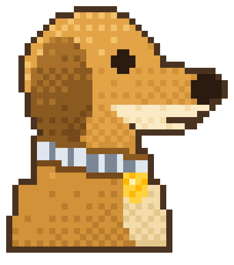

<p align="center">
  
</p>

<h1 align="center">CtrlCoco</h1>

<p align="center">
  <em>Ctrl your day, with Coco.</em>
</p>

<p align="center">
  <a href="https://github.com/samuel-geraldo/ctrl-coco/actions/workflows/tests.yml"></a>
  
  
  
</p>

CtrlCoco adalah widget desktop pribadi untuk memantau task, deadline, dan streak harian. Maskotnya **Coco**, anjing campuran mirip golden retriever milik penulis: ekspresinya berubah sesuai keadaan hari itu, jadi status pekerjaan terlihat sekilas tanpa membuka aplikasi apa pun.

Proyek ini sekaligus latihan membangun aplikasi kecil secara utuh dan rapi: desain data, logika yang terpisah dari tampilan, tes otomatis, CI, dan alur kerja issue → branch → pull request.

## Coco dan suasana hatinya

Coco hanya punya satu kondisi pada satu waktu. Aturan diperiksa berurutan, yang pertama cocok menang:

| Kondisi | Kapan | Kenapa urutannya begini |
|---|---|---|
| **Waspada** | Ada task `todo` yang deadline-nya sudah lewat atau kurang dari 24 jam lagi | Deadline yang mepet lebih mendesak daripada streak |
| **Senang** | Hari ini valid: Claude Code **dan** GitHub sudah tercatat | Hari ini sudah beres |
| **Tidur** | Selain itu (belum ada log, atau baru satu aktivitas) | Belum ada yang perlu dirayakan atau ditakutkan |

Aturan lengkap dan alasannya ada di [`docs/keputusan.md`](docs/keputusan.md).

**Streak** dihitung mundur dari hari ini (atau dari kemarin kalau hari ini belum valid), dan tidak disimpan di database: selalu dihitung ulang dari `daily_log`, jadi tidak bisa tidak sinkron.

## Fitur saat ini

- Widget tanpa bingkai, selalu di atas jendela lain, latar tembus pandang, bisa digeser dengan mouse
- Menampilkan streak dan task terdekat berdeadline
- Dari menu klik kanan: catat log hari ini, tambah task (dan area baru), tandai task selesai, dan ekspor data ke CSV
- Ekspresi Coco mengikuti kondisi, dengan animasi frame bergantian
- Data dibaca ulang otomatis setiap 60 detik
- Data tersimpan lokal di SQLite; tidak ada akun, tidak ada jaringan

Gambar Coco saat ini masih **sementara** (lingkaran berwarna per kondisi). Pixel art asli menyusul; cara mengganti gambarnya ada di bagian [Sprite](#sprite).

## Cara menjalankan

Butuh Python 3.11 atau lebih baru (dikembangkan dan diuji di 3.14) dan Windows.

CMD:

```bat
py -m venv .venv
.venv\Scripts\activate
pip install -r requirements.txt
set PYTHONPATH=src
python -m ctrlcoco
```

PowerShell:

```powershell
py -m venv .venv
.venv\Scripts\Activate.ps1
pip install -r requirements.txt
$env:PYTHONPATH = "src"
python -m ctrlcoco
```

Klik kiri lalu seret untuk menggeser widget. Klik kanan untuk membuka menu: **Log hari ini…**, **Tambah task…**, **Selesaikan task…**, **Ringkasan…**, **Ekspor CSV…**, dan **Keluar** untuk menutup.

### Mencatat log hari ini

Klik kanan widget lalu pilih **Log hari ini…**. Centang **Claude Code** dan/atau **GitHub** sesuai aktivitas hari ini, isi catatan bila perlu, lalu klik **Simpan**. Jika log hari ini sudah pernah diisi, form langsung menampilkan isinya.

- Catatan yang tidak diubah tetap tersimpan; catatan yang dikosongkan dihapus.
- Hari dihitung valid untuk streak jika kedua kotak dicentang. Setelah tersimpan, streak dan ekspresi Coco langsung berubah.
- Log hanya bisa diisi untuk hari ini.

### Menambah task

Klik kanan widget lalu pilih **Tambah task…**. Form berisi:

- **Area**: pilih dari daftar, atau ketik nama area baru. Nama yang sama dengan area yang sudah ada tanpa beda huruf besar-kecil (misalnya `kuliah` untuk `Kuliah`) memakai area itu, bukan membuat area baru.
- **Judul**: wajib diisi.
- **Deadline**: opsional, format `YYYY-MM-DD HH:MM` (misalnya `2026-11-20 23:59`). Biarkan kosong untuk task tanpa deadline.

Klik **Simpan**. Jika ada isian yang salah, pesannya muncul di form dengan warna merah, dan isian tidak hilang, jadi bisa langsung diperbaiki. Setelah tersimpan, form tertutup dan widget langsung menampilkan task terdekat. Area baru dan task disimpan sekaligus: jika task gagal disimpan, area baru juga tidak dibuat.

### Menyelesaikan task

Klik kanan widget lalu pilih **Selesaikan task…**. Form menampilkan semua task yang belum selesai, dengan deadline paling awal di atas dan task tanpa deadline di bawah. Pilih satu task lalu klik **Tandai selesai**. Task itu langsung hilang dari task terdekat di widget. Status selesai belum bisa dibatalkan dari widget.

### Ekspor ke CSV

Klik kanan widget lalu pilih **Ekspor CSV…** dan pilih folder tujuan. Dua file ditulis ke folder itu, bernama tetap:

| File | Kolom |
| --- | --- |
| `task.csv` | `area`, `judul`, `tenggat`, `status`, `dibuat`, `selesai` |
| `daily_log.csv` | `tanggal`, `claude_code`, `github`, `catatan` |

`area` berisi nama area. `status` bernilai `belum` atau `selesai`, centang log bernilai `ya` atau `tidak`, dan nilai yang kosong ditulis sebagai sel kosong. File memakai UTF-8 dengan BOM, jadi bisa langsung dibuka di Excel tanpa huruf yang rusak. Bila `task.csv` atau `daily_log.csv` sudah ada di folder itu, widget bertanya dulu sebelum menimpanya. Bila gagal menulis (misalnya folder tidak bisa ditulisi), pesan penyebabnya muncul dan widget tetap berjalan. Impor dari CSV belum ada.

### Lokasi data

Database harian disimpan di `%APPDATA%\CtrlCoco\ctrlcoco.db` (folder dibuat otomatis), jadi tidak bergantung pada folder tempat widget dijalankan dan tidak ikut masuk repo.

### Membangun CtrlCoco.exe

Untuk mendapat satu berkas `.exe` yang jalan tanpa Python terpasang (Windows). Dari akar repo:

```bat
py -m venv .venv
.venv\Scripts\activate
pip install -r requirements-build.txt
python -m PyInstaller packaging/ctrlcoco.spec --noconfirm
```

Hasilnya `dist\CtrlCoco.exe`. Database tetap di `%APPDATA%\CtrlCoco\ctrlcoco.db`, sama dengan versi sumber, bukan di folder `.exe`. Folder `assets` ikut tertanam di dalam `.exe`.

Tanpa membangun sendiri: di GitHub, tab **Actions**, workflow **build-exe**, pilih **Run workflow**, lalu unduh artifact **CtrlCoco-exe** dari halaman hasilnya. Workflow yang sama berjalan pada pull request yang mengubah `src/`, `assets/`, atau `packaging/`.

### Mencoba dengan data contoh

Untuk melihat widget terisi tanpa menyentuh data harianmu, jalankan skrip data contoh. Skrip menulis ke `demo.db` yang terpisah, dan menolak menimpa database yang sudah berisi.

```bat
set PYTHONPATH=src
python scripts/seed_demo.py
python -m ctrlcoco --db "%APPDATA%\CtrlCoco\demo.db"
```

Isinya data fiktif untuk 60 hari terakhir, selalu sama untuk tanggal yang sama:

- 4 area dengan 21 task: Kuliah (6 dari 8 selesai), Portofolio (3 dari 6), Olahraga (4 dari 4), Bahasa Inggris (1 dari 3)
- Task selesai tepat waktu, terlambat, dan tanpa deadline, serta task yang masih todo, termasuk satu berdeadline hari ini 23:59 sehingga Coco waspada
- Log harian 60 hari dengan beberapa hari bolong: streak sekarang 6 hari (hari ini belum diisi), streak terpanjang 14 hari

Untuk mengisi ulang, hapus `demo.db` lalu jalankan skripnya lagi.

## Sprite

Widget membaca frame animasi dari `assets/sprites/<kondisi>_<n>.png`, misalnya `senang_1.png` dan `senang_2.png`, diurutkan menurut nomornya. Ringkasnya:

- PNG 64×64 piksel dengan latar transparan, ditampilkan 3× (192×192) tanpa penghalusan
- 2 frame untuk `senang`, `waspada`, dan `tidur`; 3 frame `lompat` untuk perayaan
- Kondisi yang belum punya file memakai gambar sementara, jadi sebagian sprite boleh menyusul
- Sprite baru terbaca saat widget dibuka ulang

Aturan lengkap, palet warna, langkah menggambar di Piskel, dan cara mencobanya ada di [`docs/sprite.md`](docs/sprite.md).

## Struktur proyek

```text
src/ctrlcoco/
  db.py        koneksi SQLite, skema, lokasi database
  data.py      tambah dan baca area, task, daily_log (validasi tanggal ketat)
  streak.py    hitung streak dari daily_log
  mood.py      get_mood(conn, now): waspada, senang, atau tidur
  aset.py      lokasi folder assets (dari kode atau di dalam .exe)
  sprites.py   muat frame sprite, gambar sementara bila file tidak ada
  widget.py    jendela widget (PySide6), dua QTimer: animasi dan refresh
  form_task.py form tambah task (QDialog) yang dibuka dari menu klik kanan
  form_log.py  form log hari ini (centang Claude Code dan GitHub, catatan)
  form_selesai.py form untuk menandai task selesai
  ringkasan.py jendela Ringkasan (rentang 12 minggu, pesan bila belum ada data)
  heatmap.py   heatmap kalender hari valid (satu sel per hari, hanya menggambar)
  grafik_area.py grafik batang completion rate per area dan teks on-time rate
  export.py    ekspor task dan daily_log ke CSV (tanpa Qt)
packaging/
  ctrlcoco.spec konfigurasi build PyInstaller (satu .exe)
  entry.py      titik masuk .exe
scripts/
  seed_demo.py data contoh 60 hari ke database terpisah
tests/         pytest, database di memori, widget diuji tanpa layar
docs/
  erd.md             skema 3 tabel (Mermaid)
  user-stories.md    cerita pengguna per tahap
  keputusan.md       keputusan desain dan alasannya
  sprite.md          panduan menggambar sprite Coco
```

### Pilihan desain yang sengaja

- **Logika dipisah dari tampilan.** `mood.py` dan `streak.py` adalah fungsi murni atas database, jadi bisa diuji tanpa membuka jendela.
- **Waktu dikirim sebagai parameter.** `get_mood(conn, now)` tidak memanggil `datetime.now()` sendiri, sehingga kasus seperti "tepat 24 jam sebelum deadline" atau "lewat tengah malam" bisa dites tanpa menunggu jam sungguhan.
- **Streak diturunkan, bukan disimpan.** Satu sumber kebenaran: tabel `daily_log`.
- **SQL selalu berparameter** (`?`), dan `PRAGMA foreign_keys = ON` di setiap koneksi.
- **Format tanggal ketat** (`YYYY-MM-DD` dan `YYYY-MM-DD HH:MM`): `2026-3-5` ditolak, supaya urutan teks sama dengan urutan waktu.

## Tes

```bat
set PYTHONPATH=src
python -m pytest
```

Tes widget berjalan tanpa layar (`QT_QPA_PLATFORM=offscreen`). GitHub Actions menjalankan seluruh tes di Windows dengan Python 3.14 pada setiap pull request dan setiap push ke `main`.

## Cek kode (lint)

```bat
ruff check .
```

Aturan ruff ada di `pyproject.toml`. CI menjalankan perintah yang sama sebelum tes; ada temuan berarti CI gagal.

## Alur kerja

Satu fitur = satu issue = satu pull request (`Closes #N`). Perubahan di-review lewat tab *Files changed* sebelum di-merge, dan tiap tahap ditutup dengan recap pemahaman. Temuan audit kode dicatat sebagai issue, bukan diperbaiki diam-diam.

## Peta jalan

- [x] Tahap 1: ERD dan user story
- [x] Tahap 2: inti data (area, task, daily_log) dan streak
- [x] Tahap 3: widget dasar, lokasi database tetap, data contoh, latar transparan
- [x] Tahap 4a: logika kondisi Coco (`get_mood`)
- [x] Tahap 4b: mesin animasi dengan sprite sementara
- [ ] Sprite pixel art Coco yang asli
- [x] Tahap 5a: form tambah task dari menu klik kanan
- [x] Tahap 5b: centang log harian dan tombol selesai task
- [ ] Tahap 6: tinjauan mingguan (opsional)
- [ ] Pengemasan dan jalan otomatis saat Windows menyala (opsional)

## Privasi

Semua data tinggal di komputer sendiri. Repo ini publik, jadi database, `.venv`, dan data pribadi tidak pernah di-commit; data contoh di `scripts/seed_demo.py` sengaja generik (kuliah, portofolio).

## Penulis

Samuel Geraldo Tobia Lumika, [github.com/samuel-geraldo](https://github.com/samuel-geraldo)
