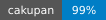

<p align="center">
  
</p>

<h1 align="center">CtrlCoco</h1>

<p align="center">
  <em>Ctrl your day, with Coco.</em>
</p>

<p align="center">
  <a href="https://github.com/samuel-geraldo/ctrl-coco/actions/workflows/tests.yml"></a>
  <a href="https://github.com/samuel-geraldo/ctrl-coco/actions/workflows/tests.yml"></a>
  <a href="https://github.com/samuel-geraldo/ctrl-coco/blob/main/LICENSE"></a>
  
  
  
</p>

CtrlCoco adalah widget desktop pribadi untuk memantau task, deadline, dan streak harian. Maskotnya **Coco**, anjing campuran mirip golden retriever milik penulis: ekspresinya berubah sesuai keadaan hari itu, jadi status pekerjaan terlihat sekilas tanpa membuka aplikasi apa pun.

Proyek ini sekaligus latihan membangun aplikasi kecil secara utuh dan rapi: desain data, logika yang terpisah dari tampilan, tes otomatis, CI, dan alur kerja issue → branch → pull request.

## Fitur

- Widget tanpa bingkai, selalu di atas jendela lain, latar tembus pandang, bisa digeser dengan mouse
- Menampilkan streak dan task terdekat berdeadline dalam gelembung bicara Coco
- Ekspresi Coco mengikuti kondisi (waspada, senang, tidur) dengan animasi frame bergantian; klik Coco membuatnya bereaksi, dan Coco melompat merayakan log yang valid, task selesai, dan tonggak streak (3, 7, 14, dan 30 hari)
- Menu klik kanan: catat log hari ini (atau hari yang terlewat), tambah task (dan area baru, dengan tombol deadline cepat), selesaikan task (bisa dibatalkan), buka Ringkasan dan Tinjauan mingguan, ekspor data ke CSV, dan jalan otomatis saat Windows menyala (dari `.exe`)
- Jendela Ringkasan 12 minggu: heatmap hari valid, streak terpanjang, completion rate per area, on-time rate, median waktu penyelesaian per area, dan produktivitas per hari dalam seminggu
- Jendela Tinjauan mingguan 7 hari terakhir: task selesai, task terlambat, hari valid, dan streak
- Form muncul di samping Coco, jadi Coco tetap terlihat
- Data dibaca ulang otomatis setiap 60 detik dan tersimpan lokal di SQLite

Gambar Coco saat ini masih **sementara** (lingkaran berwarna per kondisi). Pixel art asli menyusul, begitu pula tangkapan layar; cara mengganti gambarnya ada di bagian [Sprite](#sprite).

### Coco dan suasana hatinya

Coco hanya punya satu kondisi pada satu waktu. Aturan diperiksa berurutan, yang pertama cocok menang:

| Kondisi | Kapan | Kenapa urutannya begini |
|---|---|---|
| **Waspada** | Ada task `todo` yang deadline-nya sudah lewat atau kurang dari 24 jam lagi | Deadline yang mepet lebih mendesak daripada streak |
| **Senang** | Hari ini valid: Claude Code **dan** GitHub sudah tercatat | Hari ini sudah beres |
| **Tidur** | Selain itu (belum ada log, atau baru satu aktivitas) | Belum ada yang perlu dirayakan atau ditakutkan |

Aturan lengkap dan alasannya ada di [`docs/keputusan.md`](docs/keputusan.md).

**Streak** dihitung mundur dari hari ini (atau dari kemarin kalau hari ini belum valid), dan tidak disimpan di database: selalu dihitung ulang dari `daily_log`, jadi tidak bisa tidak sinkron.

### Menu klik kanan

Klik kiri lalu seret untuk menggeser widget; klik dua kali untuk mencatat log hari ini. Klik kanan untuk membuka menu: **Log hari ini…**, **Tambah task…**, **Selesaikan task…**, **Batalkan selesai…**, **Ringkasan…**, **Tinjauan mingguan…**, **Ekspor CSV…**, **Jalan otomatis saat Windows menyala** (kotak centang), dan **Keluar** untuk menutup.

### Mencatat log hari ini

Klik kanan widget lalu pilih **Log hari ini…**. Centang **Claude Code** dan/atau **GitHub** sesuai aktivitas hari ini, isi catatan bila perlu, lalu klik **Simpan**. Jika log hari ini sudah pernah diisi, form langsung menampilkan isinya.

Untuk mengisi hari yang terlewat, ganti **Tanggal** di bagian atas form (bawaannya hari ini). Isian langsung berganti ke log tanggal itu, dan **Simpan** menulis ke tanggal yang dipilih.

- Catatan yang tidak diubah tetap tersimpan; catatan yang dikosongkan dihapus.
- Hari dihitung valid untuk streak jika kedua kotak dicentang. Setelah tersimpan, streak dan ekspresi Coco langsung berubah.
- Tanggal bisa dipilih dari 30 hari lalu sampai hari ini; tanggal masa depan ditolak.
- Perubahan yang belum disimpan hilang bila tanggal diganti.
- Coco melompat hanya saat log hari ini baru menjadi valid, tidak saat mengisi tanggal lampau.

### Menambah task

Klik kanan widget lalu pilih **Tambah task…**. Form berisi:

- **Area**: pilih dari daftar, atau ketik nama area baru. Nama yang sama dengan area yang sudah ada tanpa beda huruf besar-kecil (misalnya `kuliah` untuk `Kuliah`) memakai area itu, bukan membuat area baru.
- **Judul**: wajib diisi.
- **Deadline**: opsional. **Tanpa deadline** dicentang sejak awal. Untuk memberi deadline, hilangkan centangnya lalu pilih tanggal dan jam (`dd/MM/yyyy HH:mm`, ada kalender), atau klik **Hari ini 23:59**, **Besok 23:59**, atau **Minggu depan** (7 hari lagi, pukul 23:59); tombol itu sekaligus menghilangkan centang.

Klik **Simpan**. Jika ada isian yang salah, pesannya muncul di form dengan warna merah, dan isian tidak hilang, jadi bisa langsung diperbaiki. Setelah tersimpan, form tertutup dan widget langsung menampilkan task terdekat. Area baru dan task disimpan sekaligus: jika task gagal disimpan, area baru juga tidak dibuat.

### Menyelesaikan task

Klik kanan widget lalu pilih **Selesaikan task…**. Form menampilkan semua task yang belum selesai, dengan deadline paling awal di atas dan task tanpa deadline di bawah. Pilih satu task lalu klik **Tandai selesai**. Task itu langsung hilang dari task terdekat di widget.

### Membatalkan status selesai

Salah menandai task? Klik kanan widget lalu pilih **Batalkan selesai…**. Form menampilkan task yang sudah selesai, yang terakhir diselesaikan di atas. Pilih satu lalu klik **Kembalikan**. Task itu kembali belum selesai, waktu selesainya dihapus, dan widget langsung diperbarui. Riwayat perubahan status tidak disimpan.

### Tinjauan mingguan

Klik kanan widget lalu pilih **Tinjauan mingguan…**. Jendela menampilkan 7 hari terakhir, termasuk hari ini:

- **Task selesai:** task yang diselesaikan dalam 7 hari itu.
- **Task terlambat:** task yang deadline-nya jatuh dalam 7 hari itu dan tidak dipenuhi, yaitu selesai sesudah deadline, atau belum selesai padahal deadline sudah lewat. Selesai tepat pada deadline dihitung tepat waktu. Tunggakan dengan deadline lebih lama tidak dihitung.
- **Hari valid:** hari dengan Claude Code **dan** GitHub tercatat.
- **Streak saat ini:** sama dengan streak di gelembung Coco, jadi bisa lebih dari 7.

Angka dibaca saat jendela dibuka; tutup lalu buka lagi untuk memperbaruinya. Bila belum ada task atau log sama sekali, yang tampil hanya pesan "Belum ada data".

### Ekspor ke CSV

Klik kanan widget lalu pilih **Ekspor CSV…** dan pilih folder tujuan. Dua file ditulis ke folder itu, bernama tetap:

| File | Kolom |
| --- | --- |
| `task.csv` | `area`, `judul`, `tenggat`, `status`, `dibuat`, `selesai` |
| `daily_log.csv` | `tanggal`, `claude_code`, `github`, `catatan` |

`area` berisi nama area. `status` bernilai `belum` atau `selesai`, centang log bernilai `ya` atau `tidak`, dan nilai yang kosong ditulis sebagai sel kosong. File memakai UTF-8 dengan BOM, jadi bisa langsung dibuka di Excel tanpa huruf yang rusak. Bila `task.csv` atau `daily_log.csv` sudah ada di folder itu, widget bertanya dulu sebelum menimpanya. Bila gagal menulis (misalnya folder tidak bisa ditulisi), pesan penyebabnya muncul dan widget tetap berjalan. Impor dari CSV belum ada.

### Jalan otomatis saat Windows menyala

Klik kanan widget lalu pilih **Jalan otomatis saat Windows menyala**. Bila bercentang, CtrlCoco terbuka sendiri setiap kali kamu login ke Windows; pilih sekali lagi untuk mematikannya (centangnya hilang). Centang mengikuti keadaan sebenarnya setiap menu dibuka.

- **Hanya dari `CtrlCoco.exe`.** Saat dijalankan dari sumber (`python -m ctrlcoco`) pilihan ini abu-abu, karena tidak ada `.exe` yang bisa ditunjuk.
- **Cara kerjanya:** satu entri bernama `CtrlCoco` di kunci registri `HKCU\Software\Microsoft\Windows\CurrentVersion\Run`, berisi path `.exe` yang sedang berjalan. Tidak butuh hak administrator, dan hanya berlaku untuk akun Windows ini.
- **Bila `.exe` dipindah**, entri lama menunjuk ke tempat yang kosong dan pilihan tampil tidak bercentang. Jalankan `.exe` di lokasi barunya, lalu pilih opsi ini untuk memperbaruinya.
- **Cara lain mematikannya:** Pengaturan Windows → Aplikasi → Aplikasi mulai otomatis, atau Task Manager → tab Startup/Aplikasi startup.
- Bila Windows menolak mengubah pengaturan (misalnya karena kebijakan komputer), pesan penyebabnya muncul dan widget tetap berjalan.

## Privasi

Singkatnya: semua data lokal, tanpa akun dan jaringan. Semua data tinggal di komputer sendiri. Repo ini publik, jadi database, `.venv`, dan data pribadi tidak pernah di-commit; data contoh di `scripts/seed_demo.py` sengaja generik (kuliah, portofolio).

## Cara instal

### Dari .exe (tanpa Python)

Unduh `CtrlCoco.exe` lalu jalankan; Python tidak perlu terpasang. GitHub Release v0.1.0 belum terbit. Sementara itu, `.exe` bisa diunduh sebagai artifact **CtrlCoco-exe** dari workflow **build-exe** di tab Actions (langkahnya ada di [Membangun CtrlCoco.exe](#membangun-ctrlcocoexe)).

### Dari sumber (butuh Python)

Butuh Python 3.11 atau lebih baru (dikembangkan dan diuji di 3.14) dan Windows.

CMD:

```bat
py -m venv .venv
.venv\Scripts\activate
pip install -r requirements.txt
set PYTHONPATH=src
python -m ctrlcoco
```

PowerShell:

```powershell
py -m venv .venv
.venv\Scripts\Activate.ps1
pip install -r requirements.txt
$env:PYTHONPATH = "src"
python -m ctrlcoco
```

### Lokasi data

Database harian disimpan di `%APPDATA%\CtrlCoco\ctrlcoco.db` (folder dibuat otomatis), jadi tidak bergantung pada folder tempat widget dijalankan dan tidak ikut masuk repo.

### Mencoba dengan data contoh

Untuk melihat widget terisi tanpa menyentuh data harianmu, jalankan skrip data contoh. Skrip menulis ke `demo.db` yang terpisah, dan menolak menimpa database yang sudah berisi.

```bat
set PYTHONPATH=src
python scripts/seed_demo.py
python -m ctrlcoco --db "%APPDATA%\CtrlCoco\demo.db"
```

Isinya data fiktif untuk 60 hari terakhir, selalu sama untuk tanggal yang sama:

- 4 area dengan 21 task: Kuliah (6 dari 8 selesai), Portofolio (3 dari 6), Olahraga (4 dari 4), Bahasa Inggris (1 dari 3)
- Task selesai tepat waktu, terlambat, dan tanpa deadline, serta task yang masih todo, termasuk satu berdeadline hari ini 23:59 sehingga Coco waspada
- Log harian 60 hari dengan beberapa hari bolong: streak sekarang 6 hari (hari ini belum diisi), streak terpanjang 14 hari

Untuk mengisi ulang, hapus `demo.db` lalu jalankan skripnya lagi.

## FAQ

**Butuh akun atau internet?** Tidak: semua data lokal, tanpa akun dan jaringan.

**Di mana datanya disimpan?** Di `%APPDATA%\CtrlCoco\ctrlcoco.db`, lihat [Lokasi data](#lokasi-data).

**Kenapa Coco masih berupa lingkaran berwarna?** Sprite pixel art aslinya belum selesai digambar. Widget memakai gambar sementara sampai filenya ada, lihat [Sprite](#sprite).

**Bagaimana mencoba tanpa mengisi data sendiri?** Pakai data contoh, lihat [Mencoba dengan data contoh](#mencoba-dengan-data-contoh).

**Bisa dipakai di macOS atau Linux?** Belum. CtrlCoco dikembangkan dan diuji di Windows, dan build `.exe` hanya untuk Windows.

**Bisa membatalkan task yang sudah selesai?** Bisa, lihat [Membatalkan status selesai](#membatalkan-status-selesai).

**Bisa terbuka sendiri saat Windows menyala?** Bisa, dari `CtrlCoco.exe`, lihat [Jalan otomatis saat Windows menyala](#jalan-otomatis-saat-windows-menyala).

**Bisa mengimpor dari CSV?** Belum; impor CSV belum dijadwalkan.

## Cara build dan tes

### Tes

```bat
set PYTHONPATH=src
python -m pytest
```

Tes widget berjalan tanpa layar (`QT_QPA_PLATFORM=offscreen`). GitHub Actions menjalankan seluruh tes di Windows dengan Python 3.14 pada setiap pull request dan setiap push ke `main`.

### Cakupan tes

```bat
set PYTHONPATH=src
python -m pytest --cov=ctrlcoco --cov-report=term-missing
```

Di akhir keluaran tampil tabel per berkas: `Cover` adalah persentase baris yang dijalankan tes, `Missing` nomor baris yang belum pernah dijalankan, dan `TOTAL` angka keseluruhan. CI menjalankan perintah yang sama, jadi tabelnya juga ada di log job `tests`. Tidak ada ambang minimum: cakupan rendah tidak menggagalkan CI.

Badge cakupan di atas dibuat oleh CI sendiri, tanpa layanan luar: sesudah tes lulus pada push ke `main`, job `badge` menulis angka `TOTAL` ke `cakupan.svg` di branch `badges`.

### Membuat gambar README

Gambar widget dan jendela Ringkasan di README dibuat oleh skrip, bukan dipotret manual, jadi bisa dibuat ulang kapan saja dan tidak memuat data pribadi. Dari akar repo:

```bat
set PYTHONPATH=src
python scripts/seed_demo.py
python scripts/tangkapan_layar.py
```

Skrip berjalan tanpa layar dan menulis empat PNG ke `docs/gambar/`: `widget_senang.png`, `widget_waspada.png`, `widget_tidur.png`, dan `ringkasan.png`. Ketiga kondisi Coco dibuat dari database sementara dengan waktu tetap. Jendela Ringkasan dibaca dari `demo.db`, dan isinya mengikuti tanggal hari ini, jadi hapus `demo.db` lalu jalankan `seed_demo.py` lagi bila gambarnya sudah lama. Skrip menolak database harian.

### Cek kode (lint)

```bat
ruff check .
```

Aturan ruff ada di `pyproject.toml`. CI menjalankan perintah yang sama sebelum tes; ada temuan berarti CI gagal.

### Membangun CtrlCoco.exe

Untuk mendapat satu berkas `.exe` yang jalan tanpa Python terpasang (Windows). Dari akar repo:

```bat
py -m venv .venv
.venv\Scripts\activate
pip install -r requirements-build.txt
python -m PyInstaller packaging/ctrlcoco.spec --noconfirm
```

Hasilnya `dist\CtrlCoco.exe`. Database tetap di `%APPDATA%\CtrlCoco\ctrlcoco.db`, sama dengan versi sumber, bukan di folder `.exe`. Folder `assets` ikut tertanam di dalam `.exe`.

Tanpa membangun sendiri: di GitHub, tab **Actions**, workflow **build-exe**, pilih **Run workflow**, lalu unduh artifact **CtrlCoco-exe** dari halaman hasilnya. Workflow yang sama berjalan pada pull request yang mengubah `src/`, `assets/`, atau `packaging/`.

## Untuk pengembang

### Sprite

Widget membaca frame animasi dari `assets/sprites/<kondisi>_<n>.png`, misalnya `senang_1.png` dan `senang_2.png`, diurutkan menurut nomornya. Ringkasnya:

- PNG 64×64 piksel dengan latar transparan, ditampilkan 3× (192×192) tanpa penghalusan
- 2 frame untuk `senang`, `waspada`, dan `tidur`; 3 frame `lompat` untuk perayaan
- Kondisi yang belum punya file memakai gambar sementara, jadi sebagian sprite boleh menyusul
- Sprite baru terbaca saat widget dibuka ulang

Aturan lengkap, palet warna, langkah menggambar di Piskel, dan cara mencobanya ada di [`docs/sprite.md`](docs/sprite.md).

### Struktur proyek

```text
src/ctrlcoco/
  db.py        koneksi SQLite, skema, lokasi database
  data.py      tambah dan baca area, task, daily_log (validasi tanggal ketat)
  streak.py    hitung streak dari daily_log
  mood.py      get_mood(conn, now): waspada, senang, atau tidur
  pesan.py     kalimat gelembung bicara Coco (tanpa Qt)
  klik.py      membedakan klik dari seret (tanpa Qt)
  perayaan.py  kapan Coco merayakan (tanpa Qt)
  posisi.py    posisi form di samping Coco (tanpa Qt)
  aset.py      lokasi folder assets (dari kode atau di dalam .exe)
  autostart.py jalan otomatis saat Windows menyala: entri Run di registri (tanpa Qt)
  sprites.py   muat frame sprite, gambar sementara bila file tidak ada
  widget.py    jendela widget (PySide6), dua QTimer: animasi dan refresh
  form_dasar.py kelas dasar bersama untuk form
  form_task.py form tambah task (QDialog) yang dibuka dari menu klik kanan
  deadline.py  deadline untuk tombol cepat (tanpa Qt)
  form_log.py  form log harian (pilih tanggal, centang Claude Code dan GitHub, catatan)
  form_selesai.py form untuk menandai task selesai
  form_batalkan.py form untuk mengembalikan task selesai ke belum selesai
  analytics.py metrik untuk jendela Ringkasan dan Tinjauan mingguan (tanpa Qt)
  ringkasan.py jendela Ringkasan (rentang 12 minggu, pesan bila belum ada data)
  tinjauan.py  jendela Tinjauan mingguan (7 hari terakhir, hanya menampilkan)
  heatmap.py   heatmap kalender hari valid (satu sel per hari, hanya menggambar)
  grafik_area.py grafik batang completion rate per area dan teks on-time rate
  export.py    ekspor task dan daily_log ke CSV (tanpa Qt)
  __main__.py  titik masuk python -m ctrlcoco
packaging/
  ctrlcoco.spec konfigurasi build PyInstaller (satu .exe)
  entry.py      titik masuk .exe
scripts/
  seed_demo.py data contoh 60 hari ke database terpisah
  tangkapan_layar.py membuat gambar README
  badge_cakupan.py membuat badge cakupan tes (dipakai CI)
tests/         pytest, database di memori, widget diuji tanpa layar
docs/
  erd.md             skema 3 tabel (Mermaid) dan view
  user-stories.md    cerita pengguna per tahap
  keputusan.md       keputusan desain dan alasannya
  sprite.md          panduan menggambar sprite Coco
```

#### Pilihan desain yang sengaja

- **Logika dipisah dari tampilan.** `mood.py` dan `streak.py` adalah fungsi murni atas database, jadi bisa diuji tanpa membuka jendela.
- **Waktu dikirim sebagai parameter.** `get_mood(conn, now)` tidak memanggil `datetime.now()` sendiri, sehingga kasus seperti "tepat 24 jam sebelum deadline" atau "lewat tengah malam" bisa dites tanpa menunggu jam sungguhan.
- **Streak diturunkan, bukan disimpan.** Satu sumber kebenaran: tabel `daily_log`.
- **SQL selalu berparameter** (`?`), dan `PRAGMA foreign_keys = ON` di setiap koneksi.
- **Format tanggal ketat** (`YYYY-MM-DD` dan `YYYY-MM-DD HH:MM`): `2026-3-5` ditolak, supaya urutan teks sama dengan urutan waktu.

### Alur kerja

Satu fitur = satu issue = satu pull request (`Closes #N`). Perubahan di-review lewat tab *Files changed* sebelum di-merge, dan tiap tahap ditutup dengan recap pemahaman. Temuan audit kode dicatat sebagai issue, bukan diperbaiki diam-diam.

## Peta jalan

Mengikuti milestone di GitHub. Perubahan yang sudah masuk tercatat di [CHANGELOG.md](CHANGELOG.md).

**v0.1.0** (tenggat 2 Desember 2026)

- [x] Tahap 1 sampai 4: ERD, inti data, streak, widget, kondisi Coco, dan animasi
- [x] Tahap 5: form tambah task, log harian, dan selesaikan task
- [x] Coco terasa hidup: gelembung bicara, klik, perayaan, form di samping Coco, deadline cepat
- [x] Jendela Ringkasan: heatmap, streak terpanjang, completion rate, on-time rate
- [x] Ekspor CSV
- [x] Data contoh 60 hari, lint di CI, dependensi terkunci, dan LICENSE MIT
- [x] Lokasi aset yang benar di `.exe` dan build `.exe` lewat GitHub Actions
- [ ] Sprite pixel art Coco yang asli (senang, waspada, tidur)
- [ ] Skrip tangkapan layar dan README bergambar
- [ ] GitHub Release v0.1.0 dengan `.exe`

**v0.2.0** (tenggat 19 Desember 2026)

- [ ] Tahap 6: jendela Tinjauan mingguan
- [x] Analitik: waktu penyelesaian task per area dan produktivitas per hari dalam seminggu
- [x] SQL view untuk statistik task
- [ ] Batalkan status selesai dan isi log untuk tanggal selain hari ini
- [x] Kelas dasar form untuk tiga form
- [x] Laporan cakupan tes dan badge di README
- [x] Opsi jalan otomatis saat Windows menyala
- [ ] CHANGELOG dan studi kasus
- [ ] Rilis v0.2.0

## Lisensi

Kode CtrlCoco berlisensi MIT; teks lengkapnya ada di [LICENSE](LICENSE).

Yang **tidak** termasuk lisensi MIT dan tidak boleh dipakai ulang tanpa izin: nama CtrlCoco, logo (`assets/logo.*`), dan karakter Coco beserta sprite-nya (`assets/sprites/`). Rinciannya ada di [assets/LICENSE-ASSETS.md](assets/LICENSE-ASSETS.md).

## Penulis

Samuel Geraldo Tobia Lumika, [github.com/samuel-geraldo](https://github.com/samuel-geraldo)
