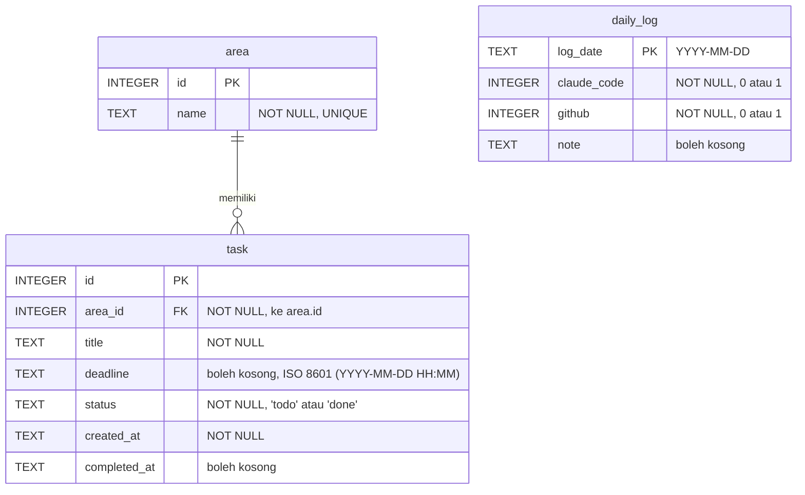

# CtrlCoco: ERD

## Diagram



## Tabel

### area
Kelompok kegiatan, misalnya `Kuliah`, `Magang`, `Pribadi`. Label magang cukup umum, tanpa detail pekerjaan kantor.

| Kolom | Tipe | Keterangan |
|---|---|---|
| id | INTEGER | PK, otomatis bertambah |
| name | TEXT | wajib, unik |

### task
Satu pekerjaan yang ingin dipantau.

| Kolom | Tipe | Keterangan |
|---|---|---|
| id | INTEGER | PK, otomatis bertambah |
| area_id | INTEGER | FK ke `area.id`, wajib |
| title | TEXT | wajib |
| deadline | TEXT | boleh kosong; format `YYYY-MM-DD HH:MM` |
| status | TEXT | `todo` atau `done`, default `todo` |
| created_at | TEXT | waktu dibuat |
| completed_at | TEXT | diisi saat status jadi `done` |

### daily_log
Satu baris untuk satu hari, diisi manual.

| Kolom | Tipe | Keterangan |
|---|---|---|
| log_date | TEXT | PK, format `YYYY-MM-DD`; satu hari hanya satu baris |
| claude_code | INTEGER | 1 jika hari itu ada aktivitas Claude Code, 0 jika tidak |
| github | INTEGER | 1 jika hari itu ada aktivitas GitHub, 0 jika tidak |
| note | TEXT | catatan bebas, boleh kosong |

## Relasi

- **area → task: satu-ke-banyak.** Satu area boleh punya nol atau banyak task (`||--o{`); setiap task wajib punya tepat satu area. Relasi disimpan lewat FK `task.area_id`.
- **daily_log berdiri sendiri.** Aturan streak hanya melihat aktivitas per hari, bukan task tertentu, jadi tidak perlu FK.
- SQLite baru memeriksa FK jika `PRAGMA foreign_keys = ON;` dijalankan di setiap koneksi (dikerjakan di Tahap 2).

## Menghitung streak dari daily_log

**Hari valid** = baris `daily_log` dengan `claude_code = 1 AND github = 1`.

```sql
SELECT log_date
FROM daily_log
WHERE claude_code = 1 AND github = 1
ORDER BY log_date DESC;
```

**Streak** = jumlah hari valid berturut-turut, dihitung mundur:
1. Mulai dari hari ini jika hari ini valid; jika belum, mulai dari kemarin (supaya streak tidak jadi 0 sebelum log hari ini diisi).
2. Mundur satu hari demi satu hari selama tanggalnya ada di daftar hari valid.
3. Berhenti di tanggal pertama yang tidak valid atau tidak tercatat.

**Kenapa streak tidak disimpan sebagai kolom:**
- Streak adalah data turunan: selalu bisa dihitung ulang dari `daily_log`, jadi cukup satu sumber kebenaran.
- Log diisi manual dan bisa dikoreksi belakangan. Kolom streak yang disimpan bisa tidak cocok lagi setelah koreksi, sedangkan hasil hitungan selalu cocok.
- Datanya kecil (sekitar 365 baris per tahun), jadi menghitung ulang setiap kali tidak terasa berat.

Catatan tipe data: SQLite tidak punya `BOOLEAN` dan `DATE`, jadi ya/tidak disimpan sebagai `INTEGER` 0/1, dan tanggal/waktu sebagai `TEXT` berformat ISO supaya urutannya tetap benar.
