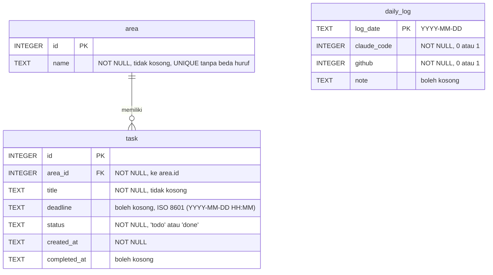

# CtrlCoco: ERD

## Diagram



## Tabel

### area
Kelompok kegiatan, misalnya `Kuliah`, `Magang`, `Pribadi`. Label magang cukup umum, tanpa detail pekerjaan kantor.

| Kolom | Tipe | Keterangan |
|---|---|---|
| id | INTEGER | PK, otomatis bertambah |
| name | TEXT | wajib, tidak boleh kosong; unik tanpa membedakan huruf besar-kecil (`COLLATE NOCASE`); lihat "Aturan nama" |

### task
Satu pekerjaan yang ingin dipantau.

| Kolom | Tipe | Keterangan |
|---|---|---|
| id | INTEGER | PK, otomatis bertambah |
| area_id | INTEGER | FK ke `area.id`, wajib |
| title | TEXT | wajib, tidak boleh kosong; lihat "Aturan nama" |
| deadline | TEXT | boleh kosong; format `YYYY-MM-DD HH:MM`, dijaga `CHECK` |
| status | TEXT | `todo` atau `done`, default `todo` |
| created_at | TEXT | waktu dibuat |
| completed_at | TEXT | diisi saat status jadi `done` |

### daily_log
Satu baris untuk satu hari, diisi manual.

| Kolom | Tipe | Keterangan |
|---|---|---|
| log_date | TEXT | PK, format `YYYY-MM-DD`, dijaga `CHECK`; satu hari hanya satu baris |
| claude_code | INTEGER | 1 jika hari itu ada aktivitas Claude Code, 0 jika tidak |
| github | INTEGER | 1 jika hari itu ada aktivitas GitHub, 0 jika tidak |
| note | TEXT | catatan bebas, boleh kosong |

## View

### v_task_selesai
Task yang sudah selesai (`status = 'done'`) digabung dengan nama areanya, plus penanda tepat waktu. View ini menaruh penyaringan dan penggabungan yang sama di satu tempat, supaya fungsi analitik di `analytics.py` tidak menyalinnya. Isinya selalu mengikuti tabel `task` dan `area`; tidak menyimpan data sendiri.

| Kolom | Asal | Keterangan |
|---|---|---|
| task_id | `task.id` | id task |
| area_id | `task.area_id` | id area |
| area_nama | `area.name` | nama area |
| judul | `task.title` | judul task |
| deadline | `task.deadline` | boleh kosong |
| dibuat | `task.created_at` | waktu dibuat |
| selesai | `task.completed_at` | waktu selesai |
| tepat_waktu | dihitung | 1 bila `selesai <= deadline` (selesai tepat pada deadline dihitung tepat waktu), 0 bila terlambat, kosong (NULL) bila task tanpa deadline |

Task yang masih `todo` tidak ada di view ini. Kedua kolom waktu berformat `YYYY-MM-DD HH:MM`, jadi perbandingan teksnya sama dengan perbandingan waktunya. Saat ini `on_time_rate` dan `median_penyelesaian_per_area` yang memakainya; `completion_rate_per_area` tidak, karena penyebutnya memuat semua task, termasuk yang masih `todo`. View untuk `daily_log` belum ada.

## Relasi

- **area → task: satu-ke-banyak.** Satu area boleh punya nol atau banyak task (`||--o{`); setiap task wajib punya tepat satu area. Relasi disimpan lewat FK `task.area_id`.
- **daily_log berdiri sendiri.** Aturan streak hanya melihat aktivitas per hari, bukan task tertentu, jadi tidak perlu FK.
- SQLite baru memeriksa FK jika `PRAGMA foreign_keys = ON;` dijalankan di setiap koneksi (dikerjakan di Tahap 2).

## Menghitung streak dari daily_log

**Hari valid** = baris `daily_log` dengan `claude_code = 1 AND github = 1`.

```sql
SELECT log_date
FROM daily_log
WHERE claude_code = 1 AND github = 1
ORDER BY log_date DESC;
```

**Streak** = jumlah hari valid berturut-turut, dihitung mundur:
1. Mulai dari hari ini jika hari ini valid; jika belum, mulai dari kemarin (supaya streak tidak jadi 0 sebelum log hari ini diisi).
2. Mundur satu hari demi satu hari selama tanggalnya ada di daftar hari valid.
3. Berhenti di tanggal pertama yang tidak valid atau tidak tercatat.

**Kenapa streak tidak disimpan sebagai kolom:**
- Streak adalah data turunan: selalu bisa dihitung ulang dari `daily_log`, jadi cukup satu sumber kebenaran.
- Log diisi manual dan bisa dikoreksi belakangan. Kolom streak yang disimpan bisa tidak cocok lagi setelah koreksi, sedangkan hasil hitungan selalu cocok.
- Datanya kecil (sekitar 365 baris per tahun), jadi menghitung ulang setiap kali tidak terasa berat.

Catatan tipe data: SQLite tidak punya `BOOLEAN` dan `DATE`, jadi ya/tidak disimpan sebagai `INTEGER` 0/1, dan tanggal/waktu sebagai `TEXT` berformat ISO supaya urutannya tetap benar.

Format tanggal dijaga di database, bukan hanya di kode: `CHECK` pada `task.deadline` dan `daily_log.log_date` menolak teks yang formatnya salah atau tanggalnya tidak ada di kalender (`2026-3-5`, `2026-02-30`, jam `24:00`), dari jalur mana pun, termasuk edit manual lewat alat seperti DB Browser for SQLite. Dengan begitu kode yang membaca (`get_streak`, `get_mood`) boleh mengandalkan formatnya.

## Aturan nama

Berlaku untuk `area.name` dan `task.title`.

- **Spasi di awal dan akhir dibuang sebelum disimpan.** `add_area(conn, " Kuliah ")` menyimpan `Kuliah`. Di `data.py` ini memakai `str.strip()`, yang membuang semua jenis spasi.
- **Kosong atau hanya spasi ditolak.** `add_area` dan `add_task` memunculkan `ValueError` ("Nama area wajib diisi", "Judul task wajib diisi"). Database ikut menjaga lewat `CHECK (trim(kolom, char(32, 9, 10, 13)) <> '')`: spasi, tab, baris baru, dan CR. `trim()` bawaan SQLite hanya membuang spasi biasa, jadi keempat karakter itu disebut satu per satu, dan ada tes yang memastikan Python dan database sepakat untuk keempatnya. Spasi Unicode yang lebih jarang (misalnya spasi tak terputus) hanya dijaga oleh `data.py`.
- **Nama area unik tanpa membedakan huruf besar-kecil.** `Kuliah` dan `kuliah` dianggap sama; pesan error menyebut nama yang sudah tersimpan (`Area sudah ada: Kuliah`). Nama disimpan dan dikembalikan `list_areas` persis seperti ditulis. Batasan `COLLATE NOCASE`: hanya huruf A–Z yang disamakan; huruf lain seperti `É` dan `é` tetap dianggap berbeda. `list_areas` juga mengurutkan tanpa beda huruf (`Kuliah`, `magang`, `Pribadi`).

## Versi skema dan migrasi

Versi skema disimpan di `PRAGMA user_version`:

| Versi | Isi |
|---|---|
| 0 | skema awal, tanpa `CHECK` tanggal dan nama |
| 1 | `CHECK` format tanggal pada `task.deadline` dan `daily_log.log_date` |
| 2 | aturan nama: `CHECK` tidak kosong pada `area.name` dan `task.title`, `UNIQUE COLLATE NOCASE` pada `area.name` |
| 3 | view `v_task_selesai`; tabel tidak berubah (versi sekarang) |

`init_db` menaikkan database v0 atau v1 langsung ke v2 dalam satu langkah:

1. Semua baris diperiksa dulu: tanggal berformat salah, nama area atau judul task kosong, dan nama area yang bentrok tanpa beda huruf (setelah spasi di awal dan akhir dibuang, jadi ` kuliah` bentrok dengan `Kuliah`). Jika ada, `ValueError` menyebut semua baris itu sekaligus, dan database tidak diubah sama sekali (`user_version` juga tetap).
2. Jika bersih, ketiga tabel dibangun ulang dalam satu transaksi; nama area dan judul task disalin setelah spasi di awal dan akhirnya dibuang. Kunci tamu dimatikan selama pembangunan ulang lalu diperiksa dengan `PRAGMA foreign_key_check`; jika ada task yang menunjuk area yang tidak ada, semuanya dibatalkan.
3. ID tidak berubah, dan ID baru melanjutkan ID terbesar yang pernah dipakai.

Migrasi hanya jalan sekali; pemanggilan berikutnya tidak mengubah apa pun.

Dari v2 ke v3 hanya view yang dibuat: `DROP VIEW IF EXISTS` lalu `CREATE VIEW`, kemudian `user_version` jadi 3. Tabel tidak dibangun ulang dan datanya tidak disalin, jadi data lama tidak berubah. `DROP` lebih dulu supaya definisi view yang baru menggantikan yang lama bila suatu hari berubah. Database v0 dan v1 lebih dulu dinaikkan ke v2 oleh langkah di atas, lalu mendapat view yang sama.
